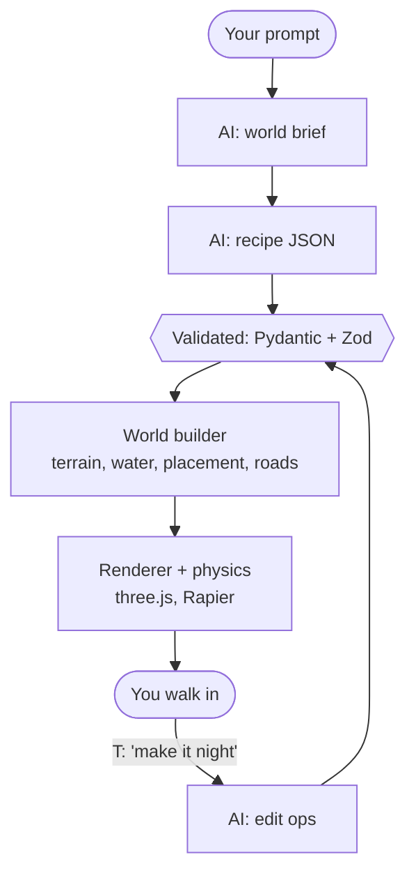
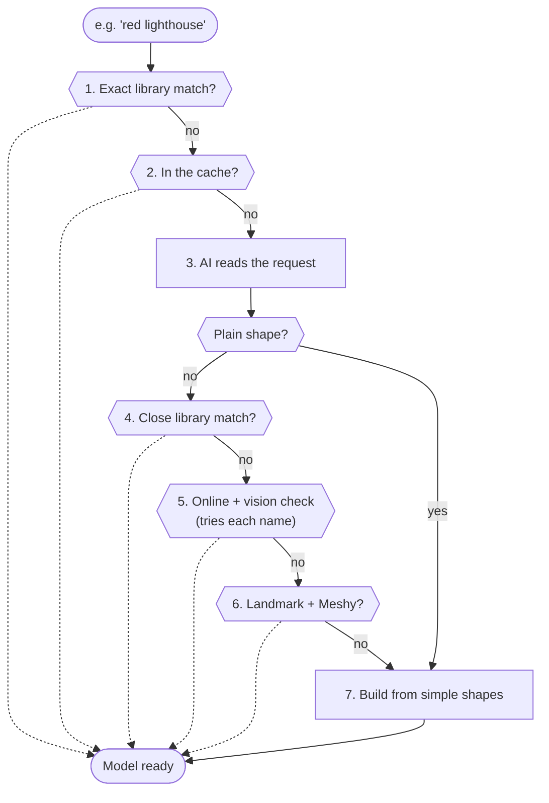

# How OASIS Works

This page explains what happens between typing a sentence and walking around the world it describes. The [README](README.md) covers what the app does and how to run it.

## The big idea: the AI suggests, the code decides

Language models are good at ideas and bad at geometry. Ask one to place 30 buildings by writing coordinates and some end up in rivers, on cliffs, or inside each other.

So in OASIS the AI never writes coordinates and never writes code. It writes a short structured description of the world, called a **recipe**: what exists, what it is like, and how things relate to each other ("a fishing village by the river", "a watchtower on the highest hill, visible from the village"). Ordinary, predictable code then turns that recipe into a world. The same recipe always gives exactly the same world.

The one exception is when the player points at a spot ("put a lighthouse *here*"). Then the browser sends the spot it measured, never a coordinate the AI made up.



## 1. From prompt to recipe (backend)

The backend is a small Python **FastAPI** server (`backend/app`). It talks to any OpenAI-compatible LLM. By default that is Sarvam, with `sarvam-105b-conversations` for briefs and edits and `glm5.3-flash` for whole worlds.

Making a world takes two AI calls:

1. **Brief** (`POST /api/brief`). A short prompt like "a snowy village" is expanded into a detailed world brief with named places and the details around them. The player's own words always win over the brief.
2. **Recipe** (`POST /api/world`). The brief and the original prompt are turned into a recipe in JSON.

A recipe (`web/src/core/recipe.ts`, mirrored in `backend/app/schemas.py`) holds:

| Part | What it says |
|---|---|
| `terrain` | The shape (plains, hills, valley, mountains, island, canyon, archipelago, ocean), roughness, height, sea level |
| `climate`, `water` | Temperature and moisture (these decide the biomes), and whether there is a river and a lake |
| `atmosphere` | Time of day, weather (clear, rain, snow, mist, storm), fog, wind |
| `palette` | Optional colours for ground, water and sky, for worlds that are not Earth-like ("a red planet") |
| `nature`, `flora` | How many trees, plants and rocks, and optionally which plants grow ("twisted spooky trees") |
| `places` | Up to 24 named places, each with a kind, a model name, a size, what you can do with it, and where it goes, as relations |
| `scenery`, `paths`, `life` | Things found out in the open, roads between places, and animals |

A place that comes in numbers, like a city or a camp, is a **group** with a layout the AI picks: a village street, a city grid, a ring around a centre piece, a line, or a loose scatter (up to 60 members).

**Validation.** Every answer is checked twice: with Pydantic on the server and Zod in the browser. Harmless slips are repaired first (a colour written as a word, a size outside small/medium/large, a relation to a place that does not exist). If the answer is still wrong, the error goes back to the AI for one more try. After two unusable answers the backend tries a backup model once. If that also fails, the player is told the AI is unavailable and no world is made. There are no preset or offline worlds.

## 2. From recipe to world (browser, deterministic)

Everything in `web/src/world` and `web/src/core` is plain TypeScript with no graphics code. It uses a seeded random generator (`mulberry32`), never `Math.random()`, so a recipe always builds the same world.

- **Terrain** (`world/field.ts`, `world/noise.ts`). Layered simplex noise is shaped by the recipe's terrain type. The map is 1024 m × 1024 m, and the land rises into a ring of mountains at the edge so the world has a natural border.
- **Water** (`world/river.ts`, `world/waterSheet.ts`). A river follows the steepest way down from high ground and is carved into the land. If it gets stuck in a hollow, it fills into a lake.
- **Biomes** (`world/biome.ts`). Each spot becomes sand, grass, forest, pine, snow, rock, desert or marsh, based on height, slope, temperature and moisture.
- **Placement solver** (`world/placement.ts`). For each place it tests 1,500 candidate sites. It throws out sites in water, on steep slopes or overlapping another place, then scores the rest against the place's relations (highest, lowest, flat, by water, near, far from, north/south/east/west of, visible from). The winner keeps its reasons, which is what the in-game place card shows as **"why here"**. Limits are relaxed only as a last resort, and a warning is noted when they are.
- **Settlements** (`world/settlement.ts`, `world/layouts.ts`). Groups are laid out as streets, grids, rings, lines or scatters on levelled ground, with farm fields, street lamps and small props around them (`world/props.ts`).
- **Roads** (`world/roads.ts`). A* pathfinding connects the places and the spawn point. It avoids water and steep ground, and crosses rivers and canyons on bridges.
- **Scatter** (`world/scatter.ts`). Trees, bushes, flowers and rocks are placed per biome, on a fixed grid with seeded jitter, with up to 8 model variants per kind so a forest is never one tree repeated.
- **Checks** (`world/checks.ts`). Every place is checked for solid ground and for being reachable on foot from the spawn. Press **C** in the game to see the list.

## 3. Rendering, physics and play

- **Chunks** (`render/chunkManager.ts`, `render/chunkWorker.ts`). The world is split into 64 m chunks. A Web Worker builds each chunk's ground and scatter off the main thread, and only the chunks around the player are loaded.
- **three.js** draws everything: instanced trees and grass that sway in the wind, an animated sea with reflections, rivers and lakes with ripples and shore foam, a day/night sky, weather, and bloom at dusk and night (`render/`).
- **Rapier** handles physics (`physics/physics.ts`): the player controller, model-shaped colliders on buildings and trees, pushable props, and cars.
- **The player** (`player/`) can walk, run, jump, swim, dive, fly with a rocket booster, and switch between first and third person. The five characters are Microsoft Rocketbox avatars with idle, walk and run animations.
- **Things that work** (`logic/`). Doors swing open, lamps and fires light up, bells ring, benches can be sat on, props can be pushed, and cars can be driven (one is parked at every spawn, plus any vehicle the AI adds). Animals graze, wander and run away from you.
- **Performance** (`render/deviceTier.ts`, `render/resolution.ts`). Smaller devices get a shorter view distance. The render resolution drops automatically when the frame rate does, or you can fix it with **R**.

## 4. Changing the world while you play

Press **T** and type a change. The browser sends the request to `POST /api/edit` along with context: the world's places, and what the crosshair is pointing at.

The AI answers with a list of **edit operations** (`web/src/core/ops.ts`), never code:

`addPlace`, `removePlace`, `movePlace`, `updatePlace`, `setAtmosphere`, `setClimate`, `setTerrain`, `setWater`, `setPalette`, `addPath`, `setNature`, `setFlora`, `addLife`

The operations are validated like a recipe, and the change is shown as a preview. **Enter** applies it and **Esc** cancels. **U** undoes it. Changes to time or weather apply instantly, while changes to land or places rebuild the affected world.

## 5. Finding a 3D model for anything

The recipe only *names* things: `"asset": "red lighthouse"`, `"asset": "giraffe"`, `"asset": "space rover"`. Nothing in OASIS is limited to a fixed list of objects, so every name has to become a real 3D model. That is the job of the **model finder** (`backend/app/assets.py`).

The idea is simple: **try the cheapest, most reliable option first, and only move on when it fails.** Free models already on disk come first. Searching the internet comes next, with an AI checking what it finds. Building something from scratch comes last.

A dotted arrow means a model was found.



### Step by step

1. **Built-in library, exact match.** OASIS ships with 186 hand-picked, tagged Quaternius CC0 models (houses, trees, animals, props) in `backend/assets/library`. If one model's tags contain every word of the request, it is used at once. This is free and instant.

2. **The cache.** Every model found online, generated or built is saved in `backend/assets/generated`, so the second time anyone asks for "giraffe" it loads straight from disk. A model found online is reused only once it has passed the vision check (step 5). This cache of 3D models is the only thing OASIS remembers between worlds.

3. **The AI reads the request** (`asset_analyse.py`). One small LLM call works out:
   - the object to search for, without colour or size words ("white stone lighthouse with a red roof" becomes "lighthouse")
   - a colour, if the whole object is one colour ("red lighthouse" gives a red)
   - three other names for the *same* thing, from most to least likely to exist ("coastal lighthouse", "beacon tower", "lighthouse building")
   - whether it is just a plain shape (a cube, a ball, a pyramid). If so, it skips the search and goes straight to step 7.

4. **Built-in library, close match.** If some library models match only part of the request ("statue of a knight" against a stag statue), the AI is shown the six closest and asked to pick one, or none. Its answer is remembered, so the same question is never asked twice.

5. **Online search** (`asset_sources.py`, `asset_vision.py`). OASIS searches **Poly Pizza**, and **Sketchfab** if a token is set, trying each name from step 3 in turn for up to 20 seconds. Before anything is downloaded, the results are filtered:
   - **License:** only CC0 or CC-BY, never non-commercial, no-derivatives or share-alike
   - **Size:** at most 30,000 triangles and 8 MB, so the game stays fast
   - **No whole scenes:** a "lighthouse interior" or "harbour scene" is skipped unless that is what was asked for

   Up to eight results go to a **vision model**, which looks at each thumbnail and judges it against the *original* request: the right object, the right object in the wrong colour, or wrong. The best approved one is downloaded and checked again in code. It must really be a glTF file, and a building must stand upright, not lie flat. If it was the right object in the wrong colour, the browser recolours it (`web/src/render/tint.ts`). Titles alone are not trusted: a "lamp in a wire cube" can be titled "cube".

6. **Meshy text-to-3D** (optional). If nothing was found online and the object is a **landmark**, Meshy can generate a model from text. It is capped at `MESHY_MAX_GENERATIONS` (5 by default), because generations cost credits and a village of houses would use them all up. Without a key or credits, the player is told so.

7. **Built from simple shapes** (`asset_procedural.py`). As a last resort, the AI designs the object as up to 24 parts (boxes, spheres, cylinders, cones, pyramids and rings), each with a size, position and colour. This is plain JSON data, never code. It is validated on both sides and the browser assembles it (`web/src/api/parts.ts`, `web/src/render/proceduralModel.ts`). The player sees a notice such as "Building red lighthouse manually".

### Example: "a red lighthouse on the cliffs"

1. There's no exact library match and nothing in the cache yet.
2. The AI reads it: search for "lighthouse", colour red, other names "coastal lighthouse", "beacon tower" and "lighthouse building".
3. Poly Pizza returns several lighthouses. The vision model approves a white one as "the right object, wrong colour".
4. It is downloaded, checked, cached and painted red in the browser.
5. Next time, any world that asks for a red lighthouse gets it instantly from the cache.

### What the player sees

- **Waiting.** The world never waits for models. It appears straight away, and each model pops in when it is ready, with a small "Loading…" notice in the corner. The browser fetches five models at a time and retries the ones that fail (`web/src/render/assetModels.ts`).
- **Sizing.** Models from different sources come in very different sizes. Each one is measured and scaled to a sensible size for what it is, or to the height the AI gave (`web/src/render/fit.ts`, `web/src/core/sizes.ts`).
- **Credit.** The place card shows where each model came from (CC0 library model, free model found online, AI-generated model, or built from parts), with the author and license of anything found online.
- **Honesty.** If something goes wrong, the player is told: Meshy has no key or credits, an object is being built manually, or new models are paused because the day's budget is used up. In that last case, the closest model already on hand stands in, so a city never shows empty plots.
- **Limits.** Online searches and the finder's AI calls have their own rate limits, separate from world generation, so one huge world cannot use up everything.

## 6. The start screen

The world behind the start screen (`web/src/ui/showcase.ts`) is hand-written and built by the same engine, with a camera that flies through it (`web/src/ui/menuFlight.ts`). Its models ship with the site (`web/public/models/bundled`), so it works even before the backend has woken up. "Watch the demo" runs a roughly 70-second self-playing tour through the real pipeline (`web/src/logic/director.ts`).

## Project layout

```
backend/
  app/
    main.py           API routes, rate limits, CORS
    service.py        brief, world and edit calls; repair and validation
    prompts.py        the prompts sent to the LLM
    schemas.py        Pydantic recipe and ops schemas
    llm.py            OpenAI-compatible client with retries and backup models
    assets*.py        model finder (library, cache, search, vision, Meshy, parts)
  assets/library/     bundled CC0 models and their manifest
shared/fixtures/      example recipe and art queries shared by both sides
web/
  src/
    core/             recipe and ops schemas (Zod), seeded RNG, sizes
    world/            deterministic world building (pure TypeScript)
    render/           three.js rendering, chunk worker, water, sky, models
    physics/          Rapier world
    player/           controller, avatar, characters, jetpack
    logic/            interactions, vehicles, wildlife, demo director
    api/              backend client
    ui/               start screen, HUD, mini-map, tutorial, notices
  public/models/      bundled characters, car and start-screen models
```

## Deployment

The backend is deployed on **Render** (Docker) and the frontend on **Vercel**.

## Credits

**3D art**
- **Quaternius** (CC0 1.0): Stylized Nature MegaKit, Medieval Village MegaKit, Ultimate Animated Animal Pack, the Sports Car, and the 186 models in `backend/assets/library/quaternius/` (from https://poly.pizza/u/Quaternius).
- **Microsoft Rocketbox** (MIT, Copyright (c) 2020 Microsoft, https://github.com/microsoft/Microsoft-Rocketbox): the playable characters Street, Tourist, Builder, Police and Woman. License notice in `web/public/models/characters/ROCKETBOX-LICENSE.txt`.
- **Poly by Google** (CC-BY 3.0, via Poly Pizza): Cow, Sheep and Fountain, used on the start screen.
- Models found while you play come from Poly Pizza or Sketchfab and are CC0 or CC-BY only. Each is credited in its in-game place card. Models made with Meshy are labelled "Generated with Meshy".

**Software:** three.js (MIT), Rapier / @dimforge/rapier3d-compat (Apache-2.0), simplex-noise (MIT), Zod (MIT), Vite (MIT), FastAPI (MIT), Pydantic (MIT), httpx (BSD-3-Clause), Uvicorn (BSD-3-Clause), thinking-orbs by Jakub Antalik (MIT).
