<p align="center">
  
</p>

<p align="center"><b>Describe a world. Walk into it. Change it by talking to it.</b></p>


## Overview

OASIS turns a sentence into a 3D world you can walk around in, right in your browser.

Type something like *"a misty pine valley with a fishing village and an old watchtower on the highest hill"*. Within about half a minute you're standing in that valley: hills and a river, a village with roads leading to it, a tower on the hilltop, deer in the woods, and morning fog. Then press **T** and keep talking to it: *"make it night"*, *"put a lighthouse there"*, *"add a camp of tents by the lake"*. The world changes while you play, and **U** undoes any change.

How it works, in short: the AI only describes the world (what is there, and how things relate to each other), and ordinary code builds it. This keeps houses out of rivers and off steep slopes, and the same plan always builds the same world.

It was built for the **Victoria VR AI Builder Hackathon 2026**, category **Prompt-to-World Creation**.

## World Showcase

Every world below was generated by OASIS from the prompt above it, with nothing edited by hand.

### Tropical island

> *"Create a tropical island with palm trees, white beaches, turquoise water, waterfalls, and small coastal villages."*

<p align="center">
  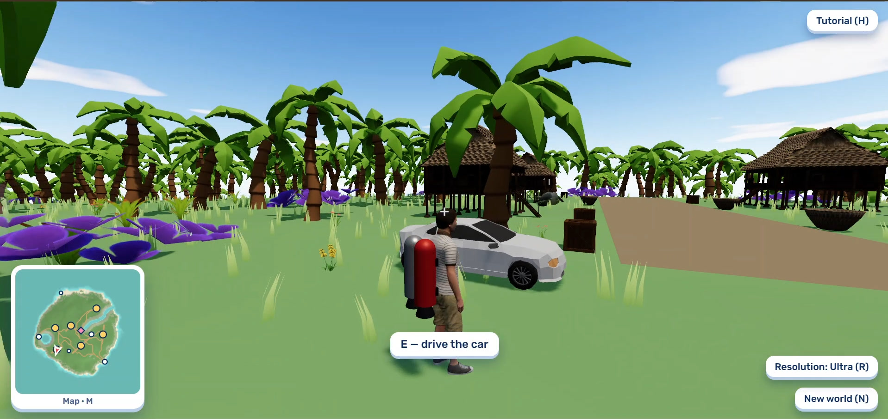<br>
  <em>Standing by the car in the stilt-house village, among palm trees</em>
</p>

<p align="center">
  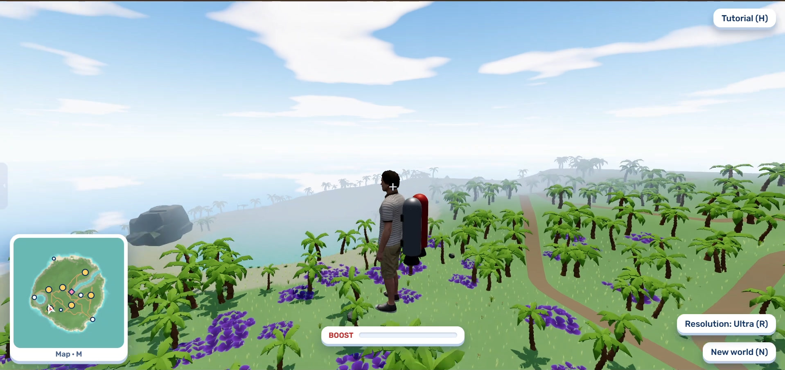<br>
  <em>Looking out over the palm forest and the beach from a hillside</em>
</p>

<p align="center">
  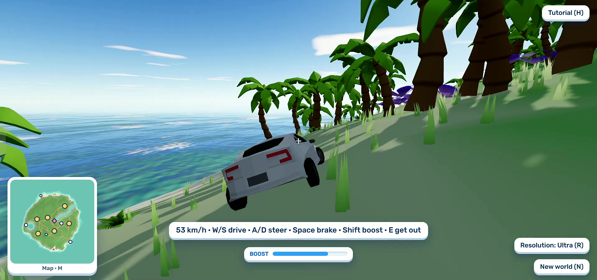<br>
  <em>Driving along the coast above the sea</em>
</p>

<p align="center">
  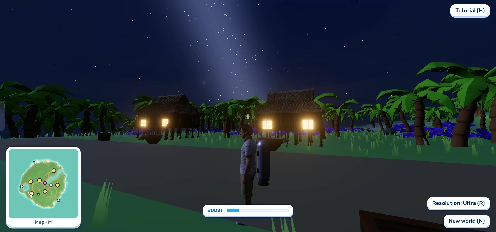<br>
  <em>The village at night, after typing "make it night"</em>
</p>

### Fantasy landscape

> *"Create a fantasy landscape filled with giant mushrooms, colourful plants, winding rivers, and unusual rock formations."*

<p align="center">
  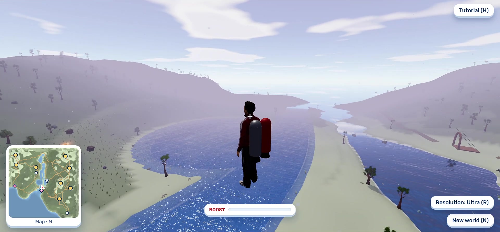<br>
  <em>Flying above the winding river with the rocket booster</em>
</p>

<p align="center">
  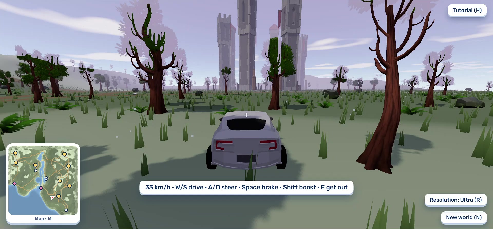<br>
  <em>Driving through the colourful forest towards the Spiral Spires of Onyx</em>
</p>

<p align="center">
  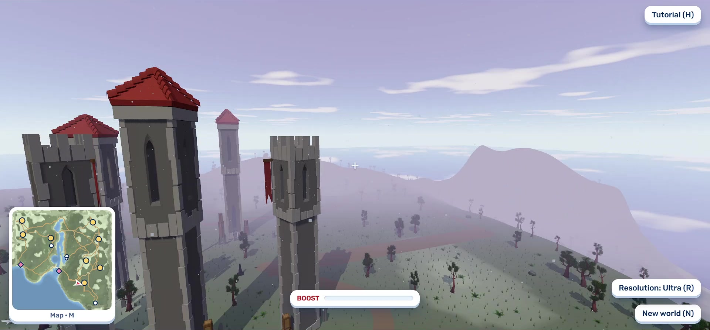<br>
  <em>The Spiral Spires of Onyx up close</em>
</p>

<p align="center">
  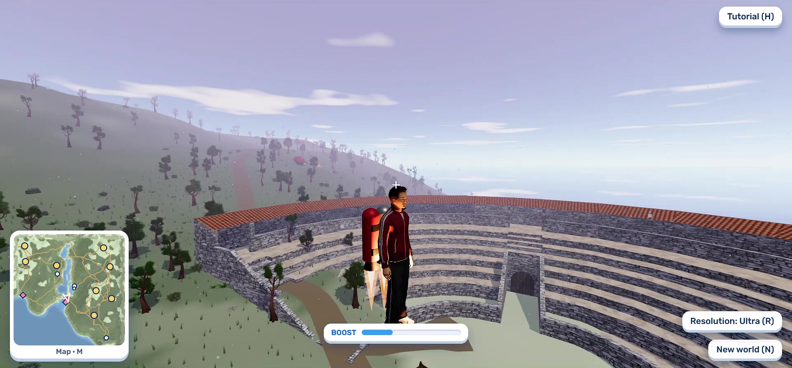<br>
  <em>The sunken amphitheatre in a dried riverbed</em>
</p>

### Purple alien world

> *"Create a surreal purple alien world with spiral-shaped trees, floating plants, glowing crystals, unusual rock formations, and violet-coloured lakes. Include strange alien vegetation, glowing flowers, and distant mountains. Use rich violet and purple lighting to create a mysterious, beautiful, and immersive alien landscape."*

<p align="center">
  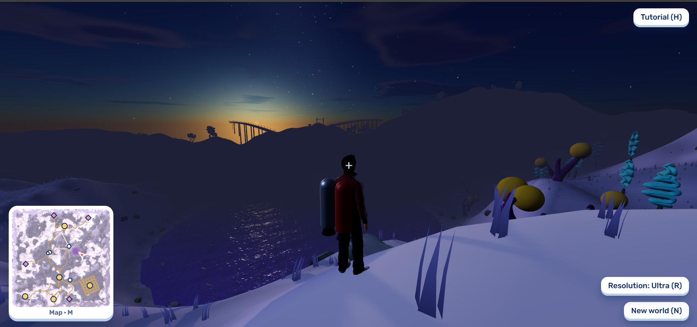<br>
  <em>A violet lake at dusk under a starry sky</em>
</p>

<p align="center">
  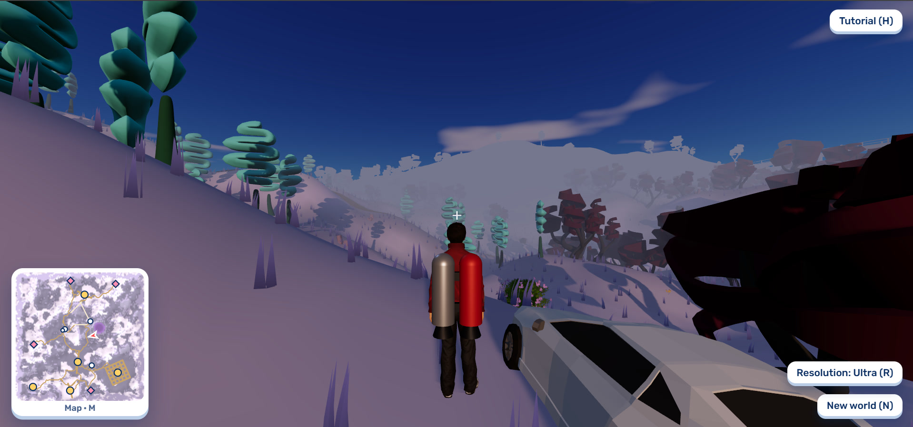<br>
  <em>Spiral-shaped trees on purple hills, with the car parked nearby</em>
</p>

<p align="center">
  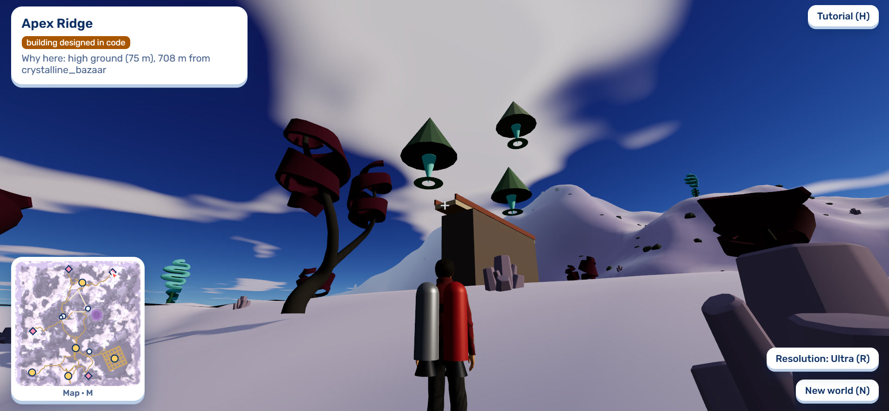<br>
  <em>Floating plants above Apex Ridge, with its "why here" card</em>
</p>

<p align="center">
  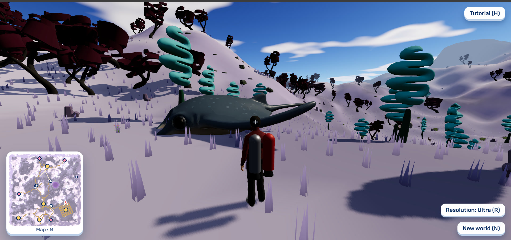<br>
  <em>A strange alien creature among the spiral trees</em>
</p>

## Features

- **Worlds from a sentence.** Forests, deserts, islands, snowy mountains, cities, alien planets: describe almost anything (only harmful requests are refused). The AI first expands a short prompt into a full plan with named places, then writes the world from it.
- **A big world to explore.** A 1 km × 1 km map with hills, rivers, lakes and seas, eight kinds of land (sand, grass, forest, pine, snow, rock, desert and marsh), and mountains rising where the land meets the edge of the map.
- **Smart placement that explains itself.** Places go where the prompt says ("by the river", "on the highest hill", "north of the village"), kept out of water, off steep slopes and apart from each other. Look at a place to see *why it is here*.
- **Villages, cities and roads.** Groups of buildings are laid out as village streets, city grids, rings, rows or loose scatters, with roads and bridges connecting them.
- **Change the world while you play.** Press **T** and type: add, remove or move things, add animals, or change the time, weather, colours, land, water or plants. Every change is previewed first, and **U** undoes it.
- **Put things where you look.** "Put a giraffe *here*" puts it where your crosshair points, even on top of a table.
- **A 3D model for anything.** If something isn't in the built-in library, OASIS searches free CC0 and CC-BY models online, checks them with a vision model, and as a last resort builds the object from simple shapes.
- **A world that works.** Day and night, rain, snow, mist and storms, lamps that light up at night, fires, bells that ring, benches to sit on, props to push, doors that swing open (on models that have one), and animals that run from you.
- **Vehicles and movement.** Drive the car parked where you start, or any car, jeep, truck, van, tractor, buggy or rover in the world. Swim and dive, fly with a rocket booster, and switch between first and third person with five characters.
- **Helpful extras.** A mini-map (**M**), a checks panel that tests each place for solid ground and a way there on foot (**C**), automatic resolution scaling (**R**), a built-in tutorial (**H**), and a self-playing demo on the start screen.

### Controls

| Key | Action |
|---|---|
| Mouse | Look around (click the world to take control, Esc gives the mouse back) |
| W A S D | Move, or steer a car |
| Shift | Run (dive in water, boost in a car) |
| Space | Jump and swim (brake in a car) |
| F | Rocket booster |
| E | Use things: doors, lights, fires, bells, seats, props, cars |
| T | Talk to the world |
| Enter / Esc | Apply or cancel a previewed change |
| U | Undo a change |
| V | First / third person |
| B | Change character |
| M | Open the mini-map |
| C | World checks |
| R | Resolution |
| N | New world |
| H | Tutorial |

## Local Setup

### Prerequisites

- **Python 3.11+**
- **Node.js 20.19+**
- An API key for an **OpenAI-compatible LLM**. The defaults are set up for [Sarvam](https://dashboard.sarvam.ai).

You'll run two local servers, each in its own terminal: the **backend** (the AI part) on port 8000 and the **web app** on port 5173. Open the web app in your browser.

### 1. Backend

```bash
cd backend
python -m venv .venv
source .venv/Scripts/activate      # Windows (Git Bash). macOS/Linux: source .venv/bin/activate
pip install -r requirements.txt
cp .env.example .env               # then fill in LLM_API_KEY
uvicorn app.main:app --port 8000
```

Check it at http://localhost:8000/api/health. It should report `"provider": "live"`.

### 2. Web app (in a second terminal)

```bash
cd web
npm install
npm run dev                        # open http://localhost:5173
```

The web app looks for the backend at `http://localhost:8000` by default. If your backend runs somewhere else, copy `web/.env.example` to `web/.env` and set `VITE_API_URL` to its address.

For a production build, run `npm run build` (the output goes to `web/dist`).

### Environment variables

The backend reads `backend/.env`. Only the LLM key is required.

| Variable | Required | What it does |
|---|---|---|
| `LLM_API_KEY` | **Yes** | Your LLM provider's API key |
| `LLM_BASE_URL` | No | OpenAI-compatible endpoint (default `https://api.sarvam.ai/v1`) |
| `LLM_MODEL` | No | Model for briefs and live edits (default `sarvam-105b-conversations`) |
| `LLM_FALLBACK_MODELS` | No | Backup models, tried in order when the main one is busy (default `sarvam-105b`) |
| `LLM_WORLD_MODEL`, `LLM_WORLD_BASE_URL` | No | A stronger model for whole worlds. Leave both empty to use `LLM_MODEL` |
| `POLY_PIZZA_KEY` | No | Lets the model finder search Poly Pizza for objects not in the library |
| `SKETCHFAB_TOKEN` | No | Lets the model finder search Sketchfab too |
| `VISION_MODEL`, `VISION_BASE_URL`, `VISION_API_KEY` | No | The vision model that checks online models (default `glm5.3-flash` on Sarvam `/v2`, using `LLM_API_KEY`) |
| `MESHY_API_KEY`, `MESHY_MAX_GENERATIONS` | No | Meshy text-to-3D for landmarks, with a cap (default 5) |
| `CORS_ORIGINS` | No | Allowed web origins (default `*`) |
| `LLM_DAILY_CAP`, `ASSET_DAILY_CAP`, `ASSET_PICK_DAILY_CAP` | No | Daily request limits |

A few more tuning options are described in `backend/.env.example`.

The web app has a single optional variable, `VITE_API_URL`: the backend's address (default `http://localhost:8000`).

> If you use a provider other than Sarvam, set `LLM_BASE_URL` and `LLM_MODEL`, and clear `LLM_WORLD_MODEL` and `LLM_WORLD_BASE_URL` (the example file points them at Sarvam). The vision check also defaults to Sarvam, so set the `VISION_*` variables too, or online models are picked by their titles instead.

> OASIS has no preset or offline worlds. Without an LLM key, or with the backend not running, the app shows **"LLM not available"** and makes no world. The start screen still works, since its world ships with the site.

## How It Works

See **[HOW_IT_WORKS.md](HOW_IT_WORKS.md)** for the architecture and how a prompt becomes a world.

## Tech Stack

| Area | Technology |
|---|---|
| Languages | TypeScript, Python |
| Web app | Vite, three.js, Rapier (`@dimforge/rapier3d-compat`), simplex-noise, Zod, Web Workers, thinking-orbs, Rubik font |
| Backend | FastAPI, Pydantic v2, Uvicorn, httpx, python-dotenv |
| AI | Any OpenAI-compatible LLM (default Sarvam `sarvam-105b-conversations`, `glm5.3-flash` for worlds and vision checks) |
| 3D models | Quaternius CC0 packs, Microsoft Rocketbox characters, Poly Pizza and Sketchfab (CC0 / CC-BY), Meshy (optional) |
| Deployment | Render (backend), Vercel (frontend) |

Art and software credits are listed in [HOW_IT_WORKS.md](HOW_IT_WORKS.md#credits).
